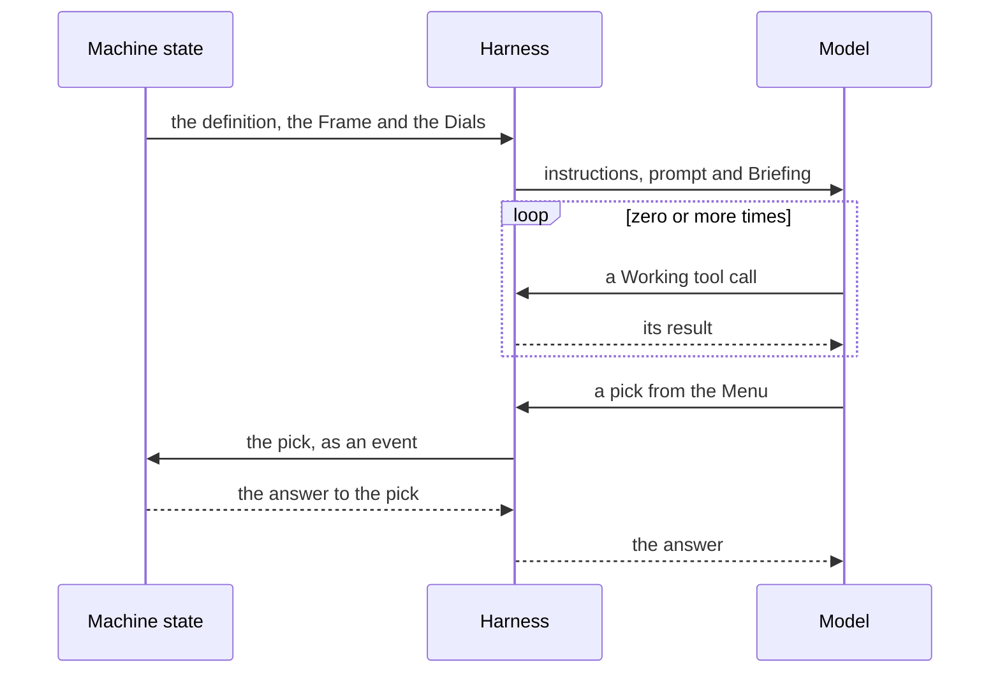

An [Agent](../reference/glossary.md#agent) is a model with instructions, which a
[Machine](../reference/glossary.md#machine) invokes to do the work of a state. Its definition tells who it is: its
model, its instructions, and what it can do to the [Workspace](../reference/glossary.md#workspace). A
[Turn](../reference/glossary.md#turn) is one answer of the Agent to one state. It holds the prompt of the state, the
work of the Agent, and its pick from its [Menu](../reference/glossary.md#menu). This page tells what a definition holds,
what a state sets for one Turn, and how a Turn ends.

## Why the work is in Turns

A long conversation in which a model decides all the work is difficult to review and difficult to control. In jr2, each
state of the Machine asks the Agent for one thing. The Agent does that thing, then picks an event. The Machine decides
where the run goes next. Thus the Agent does one thing at a time, and the [Console](../reference/glossary.md#console)
shows the state of each Turn.

A model cannot correctly control some parts of a Turn, so jr2 controls them. jr2 sets where the Agent works and how its
Turn ends. It also decides what to do when a Turn does not end. You do not write that code, so you cannot forget it.

## The definition

An Agent is an [`agent()`](../reference/authoring-surface.md#agent) under `actors` in
[`jr2Setup`](../reference/authoring-surface.md#jr2setup): `actors: { coder: agent({ … }) }`. The key is the name of the
Agent. A state invokes it with `src: "coder"`. The definition is plain data, and it has these fields:

| Field           | What it tells                                                                          |
| --------------- | -------------------------------------------------------------------------------------- |
| `model`         | The model, as `<provider>/<model id>`. It is required.                                 |
| `instructions`  | Who the Agent is and how it works. The model reads them on each Turn.                  |
| `workspace`     | What the Agent can do to the Workspace: `"write"` (the default), `"read"` or `"none"`. |
| `thinkingLevel` | How hard the model thinks, when the state sets no other level.                         |
| `description`   | A short text for the people who read the Machine. The model does not read it.          |

[`AgentDefinition`](../reference/authoring-surface.md#type-agentdefinition) gives each field.

An Agent belongs to the Machine that holds it. Two Machines in one run can each hold an Agent named `coder`, and the two
are different Agents. A Machine that you get from a package can leave its model
[`open`](../reference/authoring-surface.md#open), for you to bind with
[`customize()`](../reference/authoring-surface.md#customize). [Composition](composition.md) tells how.

`instructions` and `workspace` are the identity of the Agent. Only the definition sets them. A state cannot change them
for one Turn, because then the name of the Agent would not tell what it is.

## The Working tools

The [Working tools](../reference/glossary.md#working-tools) are the file and shell tools of an Agent: read, write, edit,
bash, grep and glob. The [Harness](../reference/glossary.md#harness) runs them in its own container. The `workspace`
field selects them:

- `"write"` gives all the Working tools.
- `"read"` gives no write tool and no edit tool. The Agent keeps bash, so a command can still write a file. A review
  Turn whose `cwd` is the review [Worktree](../reference/glossary.md#worktree) cannot move the branch with a change.
  [Workspaces](workspaces.md) tells how.
- `"none"` gives no Working tools. The Agent reads its prompt and picks from its Menu. This is a Menu-only Agent.

The field also tells where the Turn runs. An Agent with `"write"` or `"read"` works in the
[Sandbox](../reference/glossary.md#sandbox) of a Workspace, so a state invokes it in the body of a
[`workspace()`](../reference/authoring-surface.md#workspace). A Menu-only Agent has no Sandbox. Its Turn runs on the
[Instance Harness](../reference/glossary.md#instance-harness), also when a `workspace()` holds it.
[Architecture](architecture.md) shows where each Harness runs.

## What a state sets for one Turn

The `input` of the invoke is the Turn. It has five keys, and no other:

- **The [Frame](../reference/glossary.md#frame): `prompt` and `cwd`.** The prompt tells what this Turn is about. `cwd`
  is the directory where the Working tools work. A definition cannot hold a `cwd`, because the Worktree of a run exists
  only when the run starts. Under a Workspace with one [Repo Slot](../reference/glossary.md#repo-slot), the default
  `cwd` is the Worktree of that slot.
- **The [Dials](../reference/glossary.md#dials): `model` and `thinkingLevel`.** They tell how hard the Agent works on
  this Turn, and they replace the values of the definition for this Turn only. The Agent stays the same Agent.
- **`continue`.** It tells if the Turn continues the conversation of the Agent. See
  [Continue a conversation](#continue-a-conversation).

The state writes the input as a function of its context. Thus each Turn can have its own prompt and its own directory.

## An example

In this [Workflow](../reference/glossary.md#workflow), a coder fixes the tests of a
[Repo](../reference/glossary.md#repo), and a Menu-only checker reads the coder's summary. When the checker asks for
changes, the coder continues its conversation and thinks harder on that Turn:

::::tabs

:::tab{label="Anthropic"}

::include{file="../examples/concepts/agents-and-turns/anthropic/fix.ts"}

:::

:::tab{label="Local"}

::include{file="../examples/concepts/agents-and-turns/local/fix.ts"}

:::

::::

The two Agents use the model of the tab. The `coding` and `fixing` states invoke the same Agent with different prompts,
and only `fixing` sets a Dial. The checker's Turn has no `cwd`, because it has no Working tools.

## One Turn

The [Briefing](../reference/glossary.md#briefing) is the text that jr2 itself adds. The loop can run zero times: a
Menu-only Agent has no Working tools. The answer to the pick tells the model if its Turn is over.

## How a Turn ends

A Turn belongs to the state that invoked the Agent. When that state exits, the Turn is over, for any cause: a pick of
the Agent, a [Gate](../reference/glossary.md#gate), a timer, or a `CANCEL`. jr2 then stops the work of the Agent on that
Turn, and it does not prompt that Turn again.

Usually, a pick of the Agent moves the Machine out of the state, and that ends the Turn. A pick whose target stays in
the state does not end the Turn. Then the Agent can pick again, one pick at a time. [The Menu](the-menu.md) tells which
picks an Agent can make, and when.

An `agent()` actor never finishes, so an `onDone` on its invoke never runs. Give the Agent a pick, such as `finish`, and
route on it.

## Continue a conversation

Without `continue`, each Turn starts a new conversation. The model knows only the instructions, the prompt and the
Briefing. Thus the prompt must give all that the Agent needs to know.

With `continue: true`, the Turn continues the one conversation of this Agent in this Machine instance. Each state of the
Machine that invokes the Agent with `continue: true` uses the same conversation. A Turn without `continue` does not join
it. Thus, in the example, `coding` sets `continue: true` too, so that `fixing` continues the conversation of `coding`.

The conversation has no name that you write. jr2 makes its id from the run, the Machine instance and the Agent. Thus two
Agents never share a conversation. Two workers of a [Pool](../reference/glossary.md#pool) never share one either,
because each worker is a Machine instance of its own.

When jr2 sends [`agent.fault`](../reference/mechanism-events.md#agent-fault) for a continued conversation, it does not
continue that conversation again. The next Turn with `continue: true` starts a new one. Its prompt must then give the
full task again, because jr2 cannot write that prompt for you. A Harness restart is the only exception: the restarted
Harness keeps the conversation, so the next Turn continues it.

## The Briefing

The Briefing is the text that jr2 itself gives the model. It tells facts that a correct Agent needs and cannot find for
itself. It tells nothing about the task: the prompt tells the task. It has two parts:

- **The standing part** comes after the instructions, and it is the same on each Turn. It tells how the Agent acts on
  the run: with a pick from its Menu. It also tells the CPUs and the [Size](../reference/glossary.md#size) of the
  Sandbox, or that a Menu-only Agent has no Working tools.
- **The Turn part** comes after the prompt. It tells the directory of the Turn, its
  [Allowed picks](../reference/glossary.md#allowed-picks), and the notices. [The Menu](the-menu.md) tells what the
  Allowed picks are. When they change during the Turn, the Harness tells them to the model again.

A notice tells the next Turn what happened before it. For example: the conversation is new and the earlier context is
gone, or the processes of the Sandbox stopped at its memory limit. jr2 gives each notice one time, to the next Turn that
it is for.

You cannot turn the Briefing off. It contains only facts that make the Agent work better. An `instructions` that tells
the same fact again does no harm.

## When a Turn fails

jr2 tries to recover a Turn before it tells the Machine. When it cannot recover the Turn, it sends one event,
`agent.fault`, to the Machine. The Machine decides what to do next: the state that invokes the Agent can route
`agent.fault`. jr2 recovers from these failures:

- **The Harness or the model provider fails.** The Harness tries the model provider again during the Turn. When the Turn
  still fails, jr2 sends `agent.fault`. When a Harness restarts while the state is busy, jr2 starts the Turn again on
  the same conversation, and it sends no fault. If the restarted Harness cannot read the conversation, the Turn starts a
  new one, and the Briefing tells the model.
- **The Agent stops with no pick.** When the model stops and its Turn can still make a pick, jr2 prompts it again. It
  does this two times at most. Then it sends `agent.fault`.
- **The Turn is a [Runaway](../reference/glossary.md#runaway).**

A Runaway is a Turn that does not end by itself. The Harness ends a Turn when it makes the same tool call four times in
sequence, with the same arguments. It also ends a Turn that makes more than 256 tool calls on one prompt. Then jr2
starts the Turn again one time, with the same prompt, on a new conversation. When that Turn is also a Runaway, jr2 sends
`agent.fault`. jr2 does not start the Turn again when it continues a conversation, or when the Agent already made a pick
in it. Then it sends `agent.fault` immediately.

You cannot change these limits. They are a part of jr2.

## Compaction

A long Turn can fill the context window of the model. Then the model cannot answer, and the Turn fails. To prevent this,
the Harness takes a [Compaction](../reference/glossary.md#compaction) during the Turn. Before it sends the conversation
to the model, it examines the size of the context. When the context is near its limit, the Harness replaces the earlier
part of the conversation with a summary. The recent part stays. The Turn continues with the smaller context.

The summary comes from the model and the thinking level of the Turn. A Compaction changes only what the model sees. The
history of the conversation keeps all that was said.

You do not set when a Compaction occurs. jr2 calculates it from the context window and the output limit of the model. A
model of a catalog provider, such as `anthropic`, has a known context window. A custom provider gets it from
[`harness.provider.contextWindow`](../reference/config.md#harness-provider-contextwindow) or from the `contextWindow` of
the model in `models`. A model with no context window gets no Compaction.

## Rules

- `model` is required in each definition. `jr2 up` refuses a model that is still `open`.
- The input of a Turn has only `prompt`, `cwd`, `model`, `thinkingLevel` and `continue`. jr2 refuses a Turn with a
  different key.
- A Turn cannot set `instructions` or `workspace`.
- `cwd` is an absolute path. The Harness refuses a Turn with a relative `cwd`.
- Under a Workspace with more than one Repo Slot, each Turn of an Agent with Working tools sets `cwd`. jr2 refuses the
  Turn without it.
- An Agent with `"write"` or `"read"` runs in the body of a `workspace()`. jr2 refuses its Turn outside one.
- `jr2 up` sees only the models of the definitions. It cannot see a model that a Turn sets as a Dial. The Harness
  refuses a model that it cannot find when the Turn starts.
- A Turn ends when the state that invoked the Agent exits.
- After `agent.fault` for a conversation, jr2 does not continue it, except after a Harness restart.

[Set an Agent's access and Dials](../guides/set-an-agents-access-and-dials.md) gives the exact text of each refusal.

## Read next

- [Set an Agent's access and Dials](../guides/set-an-agents-access-and-dials.md)
- [The Menu](the-menu.md), [Workspaces](workspaces.md) and [Architecture](architecture.md)
- Reference: [`agent`](../reference/authoring-surface.md#agent),
  [`AgentDefinition`](../reference/authoring-surface.md#type-agentdefinition),
  [`ThinkingLevel`](../reference/authoring-surface.md#type-thinkinglevel),
  [`agent.fault`](../reference/mechanism-events.md#agent-fault) and
  [`harness.provider`](../reference/config.md#harness-provider)
- [ADR-0018](../reference/decisions/0018-instance-agents-are-definitions-jr2-assembles-the-harness.md): an Agent is a
  definition, and a Turn can set its Dials
- [ADR-0028](../reference/decisions/0028-what-an-agent-may-do-to-the-workspace-is-part-of-its-definition.md): what an
  Agent can do to the Workspace is a part of its definition
- [ADR-0057](../reference/decisions/0057-a-turn-is-its-frame-its-dials-and-whether-it-continues.md): a Turn is its
  Frame, its Dials, and `continue`
- [ADR-0024](../reference/decisions/0024-an-agents-turn-ends-with-the-state-that-asked-for-it.md): a Turn ends with the
  state that asked for it
- [ADR-0016](../reference/decisions/0016-agent-turn-mechanics-are-internal.md): jr2 owns the mechanics of a Turn
- [ADR-0062](../reference/decisions/0062-jr2-briefs-the-agent-on-its-seat-never-on-its-task.md): the Briefing
- [ADR-0035](../reference/decisions/0035-a-runaway-turn-is-ended-rerolled-once-then-a-fault.md): a Runaway
- [ADR-0036](../reference/decisions/0036-a-turn-compacts-its-own-context-mid-flight.md): Compaction
