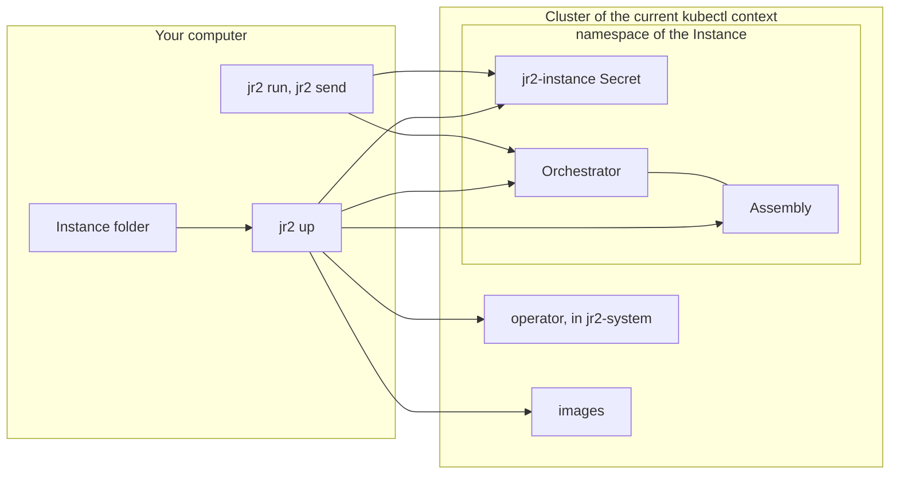

To converge is to make a cluster agree with your [Instance](../reference/glossary.md#instance) folder. One command does
it: [`jr2 up`](../reference/cli.md#up). It reads the folder, builds the images that the folder needs, and applies the
objects to the cluster of your current kubectl context. Then it publishes your Workflows to the
[Orchestrator](../reference/glossary.md#orchestrator) as an [Assembly](../reference/glossary.md#assembly). You can run
it again at any time. When nothing changed, it changes nothing.

## Why one command

A [Workflow](../reference/glossary.md#workflow) needs many parts in the cluster: the Orchestrator, its Secret, its
images and the operator. Some Workflows also need a [Sandbox Image](../reference/glossary.md#sandbox-image) or the
[Instance Harness](../reference/glossary.md#instance-harness). If you put each part there by hand, you must remember the
steps and their order. When you forget a step, the cluster is not correct, and you find the problem only when a run
fails. `jr2 up` does every step, in the correct order, each time. It tells you what it does at each step.

The Instance folder holds no record of a cluster. The kubectl context is the address, and the namespace is the identity.
Thus the same folder converges into kind on your computer and into a shared cluster. Only the kubectl context changes,
and, for a cluster that is not kind, the value that [`registry`](../reference/config.md#registry) reads from `.env`.

## Setup and usage

The diagram shows what `jr2 up` makes, and what [`jr2 run`](../reference/cli.md#run) and
[`jr2 send`](../reference/cli.md#send) use after it.

`jr2 up` reads the Instance folder. It applies the objects, and then it publishes the Assembly to the Orchestrator,
which loads it. `jr2 run` and `jr2 send` do not apply objects to the cluster. They read the Instance token from the
`jr2-instance` Secret. Then they open a port forward to the Orchestrator for the time of the command. The Orchestrator
starts the run, and it makes each [Sandbox](../reference/glossary.md#sandbox) that the run needs. For all the parts of
the cluster, see [Architecture](architecture.md).

## What jr2 up does

`jr2 up` does its steps in this order. Steps 1 to 4 change nothing in the cluster:

1. It writes the docs index of the [Kit version](../reference/glossary.md#kit-version) between the two `jr2-docs`
   markers in `AGENTS.md`. This step changes the folder, not the cluster. Thus a converge that fails still leaves the
   index correct.
2. It typechecks the Instance with the Instance's own TypeScript compiler.
3. It loads each Workflow in `workflows/`. It reads the parts that each [Machine](../reference/glossary.md#machine)
   carries: its [Agents](../reference/glossary.md#agent), its [Repos](../reference/glossary.md#repo), its Sandbox Images
   and its [Effects](../reference/glossary.md#effect). It also checks each [Chart](../reference/glossary.md#chart) file.
4. It makes the Assembly from the folder, and calculates its hash. See [The Assembly](#the-assembly).
5. It checks the Kubernetes version of the cluster.
6. It checks that the namespace is this Instance's. Before it uses a namespace for the first time, it asks you.
7. It checks that the cluster keeps pod-level resources.
8. It finds the platforms of the nodes, and it decides the address of each image.
9. It builds the Sandbox Images.
10. It makes the values of the Secrets, and checks each Secret that the config names but that `jr2 up` does not write.
11. It checks each model that an Agent uses: a pod in the cluster asks the provider for one tool call for each model.
    Until each check passes, `jr2 up` writes nothing that the Instance or the operator reads. The pod has up to 5
    minutes to start, and each model has up to 6 minutes. `jr2 up` writes each model's result as it comes.
12. It applies the operator. For a Repo with an ssh url, it asks where the deploy key comes from.
13. It applies the Secrets and the Orchestrator, and waits for the rollout. When the Machines need them, it also waits
    for the Repo cache, the Instance Harness and the [Instance Effector](../reference/glossary.md#instance-effector).
14. It publishes the Assembly to the Orchestrator. When the Orchestrator already has this Assembly, it publishes
    nothing.
15. It removes the images that nothing uses now.

`jr2 up` says `converged` only when each pod that it rolled out runs the image that it expected. The labels and the
records that `jr2 up` writes help it to skip work. They do not prove that the cluster is correct. The pods do.

The Machines decide some parts. When no registered Machine makes a Sandbox, `jr2 up` builds no Sandbox Image and runs no
Repo cache. When no Agent has `workspace: "none"`, there is no Instance Harness. When the Machines stop using the Repo
cache or the Instance Harness, `jr2 up` removes it from the namespace. The image sweep removes a Sandbox Image that
nothing names.

## The images

Each image that a converge uses is one of these kinds:

| Image                                                 | Who owns it | What `jr2 up` does                                                                                                                                                                   |
| ----------------------------------------------------- | ----------- | ------------------------------------------------------------------------------------------------------------------------------------------------------------------------------------ |
| [Kit image](../reference/glossary.md#kit-image)       | jr2         | It builds nothing. The cluster pulls `jr2-orchestrator`, `jr2-harness` and `jr2-operator` at the tag of the Kit version.                                                             |
| [Pinned image](../reference/glossary.md#pinned-image) | Upstream    | It builds nothing. The cluster pulls the Envoy image of the [Custodian](../reference/glossary.md#custodian), by its tag and its digest.                                              |
| Sandbox Image, from a `file:` URL                     | You         | It builds the folder that a [`workspace()`](../reference/authoring-surface.md#workspace) names, and the `images/default/` folder that [`jr2 init`](../reference/cli.md#init) writes. |
| Sandbox Image, from a registry                        | You         | It builds nothing. The cluster pulls the image.                                                                                                                                      |

The Custodian is a container in each [Harness](../reference/glossary.md#harness) pod.
[Workspaces](workspaces.md#the-sandbox-image) explains what a Sandbox Image holds.

The tag of each image that `jr2 up` builds is a hash of the inputs of that image and of its platforms. Thus a new tag
means new content, and the same tag means the same content. This rule has three results:

- When the inputs of an image do not change, `jr2 up` does not build it again. A converge with no change builds no
  image.
- When an input changes, the tag changes. A Sandbox that starts after the converge uses the new image. A Sandbox that
  runs does not, as the text below explains.
- `--force` builds each image again, even when its tag did not change.

The Kit images are at `ghcr.io/snapwich` by default. A cluster that cannot pull from there pulls from a mirror. A mirror
holds the same tags. [`kitRegistry`](../reference/config.md#kitregistry) names the mirror, and
[`jr2 kit push`](../reference/cli.md#kit-push) fills it. `jr2 up` never pushes to `kitRegistry`. `kitRegistry` also
changes where the cluster pulls the Pinned image, and `jr2 kit push` copies it to the mirror too.

`jr2 up` sends each image that it builds to the nodes in one of two ways:

- When you set `registry`, it pushes the image to that registry, and the nodes pull it.
- When you do not set `registry`, on a kind cluster it loads the image into the nodes with `kind load`. A context whose
  name starts with `kind-` is a kind cluster.

A change to a Sandbox Image changes only the Sandboxes that start after the converge. A Sandbox that runs keeps its
image, because a new pod would lose its [Worktrees](../reference/glossary.md#worktree) and the commits that you did not
push. `jr2 up` tells you how many running [Workspaces](../reference/glossary.md#workspace) keep each older image.

`jr2 up` uses Docker only to build a Sandbox Image. When no registered Machine makes a Sandbox, it builds no image, and
your computer does not need Docker for `jr2 up`.

## The Assembly

The Assembly is what the Orchestrator loads from your Instance folder: the Workflows in `workflows/`, `jr2.config.ts`,
the folders of the `file:` Sandbox Images, and the packages that they import. The image of the Orchestrator is a Kit
image, the same for each Instance. Your code is not in it. `jr2 up` makes the Assembly and publishes it to the
Orchestrator that runs.

- **No restart.** The Orchestrator loads a new Assembly in its process. A change to a Machine or to `jr2.config.ts`
  starts no pod again. Thus a port forward to the [Console](../reference/glossary.md#console) stays open.
- **The Kit packages come from the image.** `jr2 up` removes `@jr2/orchestrator` and each package that it needs, such as
  `xstate` and `zod`, from the Assembly. The Orchestrator uses its own copies. A second copy of one of these packages
  makes Machines whose Menus are empty, so `jr2 up` refuses it.
- **One hash for each Assembly.** The hash comes from the files and the paths of the Assembly. When the Orchestrator
  already has the Assembly with this hash, `jr2 up` does not publish it again.
- **The Orchestrator checks it again.** Before it makes an Assembly current, the Orchestrator loads each Workflow and
  does the same checks as `jr2 up`. When it refuses the Assembly, the Assembly that was current stays current.
- **A run keeps its Assembly.** A new run starts under the current Assembly. A live run keeps the Assembly that it
  started under, also after a restart. Thus a publish does not stop a run that waits at a
  [Gate](../reference/glossary.md#gate). `jr2 run`, `jr2 runs` and the Console use the current Assembly. The
  Orchestrator removes an older Assembly when no live run holds it.
- **Only `jr2 up` publishes.** The publish needs the publish token, which is in the `jr2-instance` Secret. `jr2 up`
  reads it through the kubectl context. The Instance token does not publish, and an Agent cannot publish code.

[`jr2 status`](../reference/cli.md#status), with no run id, shows the current Assembly and each Assembly that a live run
holds.

## Kit version and Handoff

An Instance has one Kit version: the version of the `@jr2/orchestrator` package that the Instance pins. It is the tag of
each Kit image, the image of the Orchestrator too. `jr2 init` pins `@jr2/orchestrator` and `@jr2/cli` to one exact
version in `package.json`. The Assembly records the Kit version, and the Orchestrator refuses an Assembly for a
different Kit version. When you change the Kit version, one `jr2 up` starts the Orchestrator on its new image first, and
then it publishes the Assembly for the new version.

You install the [jr2 CLI](../reference/glossary.md#jr2-cli) two times: one time with `npm i -g`, and one time in the
Instance, from its `package.json`. In an Instance folder, the global `jr2` runs the Instance's own `@jr2/cli`, with the
same arguments. This is the [Handoff](../reference/glossary.md#handoff). Thus the CLI that runs is always the one that
the Instance pins. In the Instance, the version of your global `jr2` does not matter.
[`jr2 version`](../reference/cli.md#version) shows the CLI that runs, the global CLI that handed off, the Kit version of
the Instance, and what the cluster runs.

All the Instances on a cluster share one operator. `jr2 up` upgrades an older operator. It does not downgrade an
operator that a different Instance upgraded to a later version.

## Clean up

When each tag is a content hash, each change makes a new image. Ten changes to a Dockerfile make ten images. Thus
`jr2 up` removes the old images at the end of each converge that succeeds.

An image is garbage when no live root in the cluster names it. The roots are the image map of each Instance on the
cluster, the image of each Sandbox, and the images of the pods that run. jr2 removes only an image that it built and
labeled. It removes the image from your computer and, on a kind cluster, from the nodes. It never removes an image that
it did not build, such as the Pinned image. The output gives the size that it removed:
`swept <count> image(s) (<size>)`.

`jr2 up` and [`jr2 down`](../reference/cli.md#down) remove the images. [`jr2 gc`](../reference/cli.md#gc) does the same
work at a different time, for example when your disk is full. It also removes each Repo resource that no Machine binds
and that no run used in the last 7 days, by default. `--repo-ttl` changes the time. `jr2 gc --dry-run` shows what it
would remove, and removes nothing.

`jr2 down` deletes the namespace of the Instance. The runs, the store of the runs and the Sandboxes go with it.
`jr2 down --all` also removes the operator.

## Rules

- `jr2 up` changes nothing in the cluster when the Instance does not typecheck.
- `jr2 up` changes nothing in the cluster when the Assembly holds a second copy of a Kit package, or when its Kit
  version is not the Kit version of the CLI.
- `jr2 up` changes nothing in the cluster when a registered Machine has an [Open](../reference/glossary.md#open) part
  that is not bound. Examples are a [Repo Slot](../reference/glossary.md#repo-slot) with no url and an Agent with no
  model.
- `jr2 up` refuses a cluster that runs a Kubernetes version earlier than 1.35. It also refuses a cluster that does not
  keep pod-level resources.
- `jr2 up` refuses a namespace that belongs to a different Instance. It asks you before it uses a namespace for the
  first time. `--yes` gives the answer for CI.
- `jr2 up` refuses a cluster that is not kind when `registry` is not set.
- Each verb that reads the Instance, other than `jr2 version`, refuses when the Instance and the CLI do not use the same
  copy of `@jr2/orchestrator`.
- `jr2 up` never downgrades the operator.
- `jr2 up` never replaces the pod of a Sandbox that runs.
- The Orchestrator refuses an Assembly that fails its checks, and the Assembly that was current stays current.
- Only the publish token publishes an Assembly.
- A converge that fails removes no image.
- `jr2 gc`, `jr2 up` and `jr2 down` remove only images that jr2 built and that no live root names.

[Fix a failed converge](../guides/fix-a-failed-converge.md) gives the refusal text of each rule, and the fix.

## Read next

- [Iterate on a Machine on kind](../guides/iterate-on-a-machine-on-kind.md)
- [Move from kind to a shared cluster](../guides/move-from-kind-to-a-shared-cluster.md)
- [Mirror the Kit images](../guides/mirror-the-kit-images.md)
- [Upgrade the Kit version](../guides/upgrade-the-kit-version.md)
- [Clean up](../guides/clean-up.md)
- [Fix a failed converge](../guides/fix-a-failed-converge.md)
- Reference: [`jr2 up`](../reference/cli.md#up), [`jr2 down`](../reference/cli.md#down),
  [`jr2 gc`](../reference/cli.md#gc), [`jr2 kit push`](../reference/cli.md#kit-push),
  [`jr2 version`](../reference/cli.md#version), [`registry`](../reference/config.md#registry),
  [`kitRegistry`](../reference/config.md#kitregistry) and [`platforms`](../reference/config.md#platforms)
- [ADR-0019](../reference/decisions/0019-one-converging-command-against-the-current-context.md): one converging command
  against the current context
- [ADR-0038](../reference/decisions/0038-jr2-up-builds-every-image-it-deploys.md): `jr2 up` builds each image that the
  Instance runs
- [ADR-0039](../reference/decisions/0039-image-garbage-collects-by-reachability.md): `jr2 gc` removes the images that
  nothing reaches
- [ADR-0041](../reference/decisions/0041-a-build-the-host-already-holds-is-not-spent-again.md): a build that the
  computer already holds is not done again
- [ADR-0044](../reference/decisions/0044-kit-images-live-at-a-canonical-home-a-self-host-mirrors-it.md): the Kit images
  and their mirror
- [ADR-0045](../reference/decisions/0045-the-platform-joins-the-image-address-and-the-cluster-chooses-it.md): the
  platform is a part of the image tag
- [ADR-0046](../reference/decisions/0046-a-converge-failure-carries-its-diagnosis.md): a failed converge says why
- [ADR-0056](../reference/decisions/0056-a-global-jr2-hands-off-to-the-instances-own-and-an-instance-has-one-kit-version.md):
  the Handoff, and one Kit version for each Instance
- [ADR-0069](../reference/decisions/0069-the-orchestrator-is-a-kit-image-and-an-instance-publishes-its-assembly.md): the
  Orchestrator is a Kit image, and an Instance publishes its Assembly
